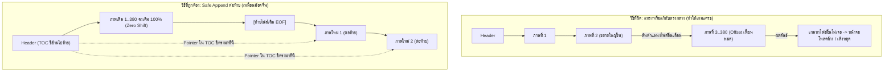

# คู่มือเชิงลึก: วิธีการนำภาพไปต่อท้าย (Append to EOF) และแก้พอยน์เตอร์ชี้ไปท้าย

เอกสารนี้อธิบายหลักการทำงาน ขั้นตอนคำนวณ และโค้ดตัวอย่างอย่างละเอียดของเทคนิค **"Safe Append"** ซึ่งเป็นเทคนิคที่ม็อดภาษาจีนใช้ในการดัดแปลงไฟล์ `resident_lang_jp.fad` ภายใน `fairy_1_00.dat` โดยไม่ทำให้เกมแครชหรือค้างระหว่างโหลดฉาก

---

## 1. ทำไมต้อง "ต่อท้าย" แทนที่จะ "แก้ทับที่เดิม"?



### ปัญหาของการแก้ทับที่เดิม (In-place Shift)
ไฟล์ `resident_lang_jp.fad` มีขนาดถึง **248 MB** ภายในบรรจุไฟล์ภาพและเสียงหลายร้อยรายการเรียงต่อกันเป็นตับ หากเรานำภาพภาษาไทยที่มีขนาดไบต์ไม่เท่ากับภาพญี่ปุ่นเดิมไปใส่แทนที่ตรงกลาง:
1. ไฟล์ที่อยู่ข้างหลังทั้งหมดจะถูก **"ดันเลื่อนตำแหน่ง" (Offset Shift)**
2. หากสารบัญไม่ได้อัปเดตครบทุกไฟล์ หรือเอนจินเกมจำแคชตำแหน่งเดิมไว้ เกมจะอ่านข้อมูลผิดจุดทันที ทำให้เกมเด้งหลุด (Crash) ระหว่างโหลด

### ข้อดีของ Safe Append (ต่อท้ายไฟล์)
1. **เนื้อหาเดิม 248 MB ไม่ขยับแม้แต่มิลลิเมตรเดียว:** ไฟล์เดิมทั้งหมดอยู่ที่ Offset เดิม 100%
2. **ภาพแปลไทยไปอยู่ท้ายสุด:** เพิ่มเนื้อที่ต่อท้ายไฟล์ออกไปเรื่อยๆ
3. **แก้แค่สารบัญ (TOC) 32 ไบต์:** บอกเกมแค่ว่า *"ภาพนี้ไม่ได้อยู่ที่เดิมแล้วนะ ให้เดินไปอ่านที่ท้ายไฟล์แทน"*

---

## 2. ขั้นตอนที่ 1: โครงสร้างของข้อมูลภาพที่จะนำไปต่อท้าย (Payload Structure)

เมื่อเราจะนำภาพ NLTX ไปต่อท้ายไฟล์ เราไม่ได้โยนไฟล์ NLTX ดิบๆ เข้าไปเฉยๆ แต่เอนจินของเกมบังคับให้มีบล็อกข้อมูลมาตรฐานขนาดดังนี้:

```
[ โครงสร้าง 1 บล็อกภาพที่ต่อท้าย ]
┌─────────────────────────────────────────────────────────────┐
│ 1. Subheader (32 Bytes):                                    │
│    - Byte 08..15: entry_size (ขนาดรวมทั้งหมดของบล็อกนี้)    │
│    - Byte 16..23: unk1 (ค่า Flag ดั้งเดิมจาก TOC)           │
├─────────────────────────────────────────────────────────────┤
│ 2. Image Descriptor (32 Bytes):                             │
│    - Byte 00..07: nltx_size (ขนาดของข้อมูล NLTX แท้ๆ)       │
│    - Byte 08..11: Width (2B) + Height (2B)                  │
│    - Byte 16..19: Format Flag (0x0B010080 = DXT/BC Format)  │
│    - Byte 20..23: Width (2B) + Height (2B)                  │
├─────────────────────────────────────────────────────────────┤
│ 3. Raw NLTX Data (ขนาดตามไฟล์ nltx_size ไบต์)               │
├─────────────────────────────────────────────────────────────┤
│ 4. Alignment Padding (0 ถึง 15 ไบต์):                        │
│    - เติม \x00 เพื่อให้ขนาดรวมหารด้วย 16 ลงตัว              │
└─────────────────────────────────────────────────────────────┘
```

### การคำนวณขนาดบล็อกรวม (`entry_size`):
$$\text{entry\_size} = \text{Align16}(32 + 32 + \text{len(NLTX)})$$
*(เช่น ถ้า NLTX ขนาด 91,459 ไบต์ $\rightarrow$ รวม Header 64 ไบต์ = 91,523 ไบต์ $\rightarrow$ ปัดขึ้นหาร 16 ลงตัว = 91,536 ไบต์)*

---

## 3. ขั้นตอนที่ 2: วิธีการคำนวณตำแหน่งและชี้พอยน์เตอร์ไปท้าย (Pointer Relocation)

ตารางสารบัญ (TOC) ใน Header ของ FAD อยู่ที่ Offset **`0x1018`** โดยแต่ละภาพจะมีช่องข้อมูลของตัวเองขนาด **32 ไบต์**:

```
[ ช่อง TOC 32 ไบต์ของภาพแต่ละ Index ]
Offset 0x00 - 0x07 (8 Bytes, uint64): entry_size  <-- ขนาดรวมของบล็อกใหม่
Offset 0x08 - 0x0B (4 Bytes, uint32): rel_offset  <-- พอยน์เตอร์ชี้ไปท้ายไฟล์! (สำคัญที่สุด)
Offset 0x0C - 0x0F (4 Bytes, uint32): unk1        <-- ค่าเดิมจากไฟล์ต้นฉบับ
Offset 0x10 - 0x13 (4 Bytes, uint32): width       <-- ความกว้างใหม่ (Pixels)
Offset 0x14 - 0x17 (4 Bytes, uint32): height      <-- ความสูงใหม่ (Pixels)
Offset 0x18 - 0x1F (8 Bytes, uint64): unk2        <-- ค่าเดิมจากไฟล์ต้นฉบับ
```

### สูตรคำนวณพอยน์เตอร์:
1. **หาตำแหน่งช่องสารบัญของรูป:**
   $$\text{TOC\_Pos} = 0x1018 + (\text{Index} \times 32)$$
2. **หาตำแหน่งท้ายไฟล์ปัจจุบันที่จะนำภาพไปต่อ:**
   $$\text{Target\_Offset} = \text{Current\_FAD\_Size}$$
3. **เขียนพอยน์เตอร์ใหม่ทับลงในช่อง TOC:**
   บันทึกค่า `Target_Offset` ลงที่ช่อง `rel_offset` (Offset ในช่องคือ `TOC_Pos + 8`)

---

## 4. ตัวอย่างภาพจริง: การต่อท้ายไตเติลหลัก (Index 205: `ui_1000_タイトル01.nltx`)

ขอยกตัวอย่างภาพป้ายไตเติลหลักภาษาไทย เพื่อให้เห็นภาพตัวเลขจริง:

### ข้อมูลเดิม (Original):
- **Index:** `205`
- **ตำแหน่งช่อง TOC ใน FAD:** `0x1018 + (205 * 32)` = **`0x29B8`**
- **ตำแหน่งเดิมของภาพญี่ปุ่น:** `0x07FB3BF0` (อยู่กลางไฟล์ที่ 133.9 MB)
- **ขนาดเดิม:** 214,176 ไบต์ (กว้าง 2048 x สูง 512)

### ข้อมูลใหม่หลังทำ Safe Append (Patched):
- **ขนาดไฟล์ FAD ดั้งเดิม:** `248,349,600` ไบต์ (`0x0ECB81C0`)
- **สร้างบล็อกภาพไทย:** ขนาดรวม `91,536` ไบต์
- **นำไปต่อท้ายไฟล์ที่:** `0x0ECB81C0` (ท้ายไฟล์เดิมพอดี)
- **แก้ช่อง TOC ที่ `0x29B8`:**
  - `entry_size` = `91,536` (เดิม 214,176)
  - `rel_offset` = **`0x0ECB81C0`** *(พอยน์เตอร์ถูกเปลี่ยนจาก `0x07FB3BF0` ให้ชี้กระโดดมาท้ายไฟล์ทันที!)*
  - `width` = 2048, `height` = 512

เมื่อเอนจินเกมเรียกภาพไตเติล (Index 205):  
เกมจะอ่านสารบัญที่ `0x29B8` $\rightarrow$ ได้รับคำสั่งให้วิ่งไปโหลดข้อมูลที่ท้ายไฟล์ `0x0ECB81C0` $\rightarrow$ ได้ภาพภาษาไทยคมชัดสวยงาม โดยที่ไฟล์อื่นไม่ได้รับผลกระทบใดๆ!

---

## 5. โค้ดตัวอย่าง Python ที่ใช้งานจริง (Reference Implementation)

```python
import struct

def append_and_repoint_texture(fad_data, fad_header, idx, nltx_bytes, width, height):
    """
    1. ประกอบบล็อกข้อมูลภาพ
    2. นำไปต่อท้ายไฟล์ FAD
    3. แก้พอยน์เตอร์ใน FAD Header ให้ชี้ไปที่ท้ายไฟล์
    """
    # 1. หาตำแหน่งท้ายไฟล์ปัจจุบัน
    current_eof = len(fad_data)
    
    # 2. คำนวณขนาดบล็อก
    nltx_sz = len(nltx_bytes)
    entry_sz = (64 + nltx_sz + 15) & ~15  # หาร 16 ลงตัว
    pad_len = entry_sz - (64 + nltx_sz)

    # 3. อ่านค่า Flag unk1 และ unk2 ดั้งเดิมจาก TOC
    toc_pos = 0x1018 + (idx * 32)
    orig_sz, orig_off, unk1, orig_w, orig_h, unk2 = struct.unpack_from("<QIIIIQ", fad_header, toc_pos)

    # 4. สร้าง 32-byte Subheader
    subhdr = bytearray(32)
    struct.pack_into("<Q", subhdr, 8, entry_sz)
    struct.pack_into("<I", subhdr, 16, unk1)

    # 5. สร้าง 32-byte Image Descriptor
    desc = bytearray(32)
    struct.pack_into("<Q", desc, 0, nltx_sz)
    struct.pack_into("<HH", desc, 8, width, height)
    struct.pack_into("<I", desc, 16, 0x0B010080)   # DXT Format Flag
    struct.pack_into("<HH", desc, 20, width, height)

    # 6. รวมก้อน Payload แล้วนำไปต่อท้ายไฟล์ FAD
    payload = bytes(subhdr) + bytes(desc) + nltx_bytes + (b"\x00" * pad_len)
    fad_data.extend(payload)

    # 7. แก้พอยน์เตอร์ในตาราง TOC ให้ชี้ไปที่ท้ายไฟล์ (current_eof)
    struct.pack_into(
        "<QIIIIQ",
        fad_header,
        toc_pos,
        entry_sz,     # ขนาดใหม่
        current_eof,  # ชี้ไปตำแหน่งท้ายไฟล์!
        unk1,         # ค่าคงเดิม
        width,        # ความกว้างใหม่
        height,       # ความสูงใหม่
        unk2          # ค่าคงเดิม
    )
    
    print(f"[+] Re-pointed Index {idx:3d} -> New EOF Offset: 0x{current_eof:08X} (Size: {entry_sz:,} B)")
```

---

## 6. สรุปภาพรวมกระบวนการ (Checklist)

| ขั้นตอน | การกระทำ | ตำแหน่งเป้าหมาย | ผลลัพธ์ |
| :---: | :--- | :---: | :--- |
| **1** | คัดลอก FAD ตัวเดิมทั้งก้อน | `0x00000000` - `0x0ECB81C0` | ข้อมูลเดิมคงอยู่ครบ 100% ไม่เลื่อนตำแหน่ง |
| **2** | เตรียมบล็อกภาพไทย 70 รูป | Subhdr (32B) + Desc (32B) + NLTX | ได้โครงสร้างไบนารีที่เอนจินเกมรู้จัก |
| **3** | ต่อข้อมูลภาพเรียงกันท้ายไฟล์ | ต่อท้ายตั้งแต่ `0x0ECB81C0` ไปเรื่อยๆ | ไฟล์ขยายขนาดออกด้านหลังอย่างปลอดภัย |
| **4** | แก้พอยน์เตอร์ใน TOC | ช่อง `0x1018 + (idx * 32)` | ชี้ค่า `rel_offset` ไปยังตำแหน่งต่อท้ายใหม่ |
| **5** | เขียน Header ทับส่วนหัว 16KB | `0x00000000` - `0x00004000` | สารบัญอัปเดตชี้ไปท้ายไฟล์สมบูรณ์ |
| **6** | ประกอบเข้า `fairy_1_00.dat` | เขียนสตรีมไฟล์ทั้งก้อน | เกมโหลดภาพภาษาไทยได้ครบทุกรูป 100% ไม่เด้ง |
