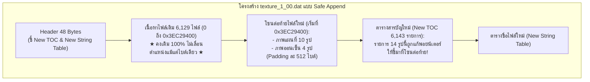

# แผนงาน โครงสร้าง และตำแหน่งพิกัดภาพใน `texture_1_00.dat`

> เอกสารนี้บันทึกโครงสร้างทางเทคนิค วิธีการทำ Safe Append ต่อท้ายไฟล์ และตารางพิกัดตำแหน่งจริงของรูปภาพแผนที่และออนเซ็นทั้งหมด 14 รูปใน `texture_1_00.dat`

---

## 1. ข้อมูลพื้นฐานของไฟล์ `texture_1_00.dat`

- **ขนาดไฟล์ต้นฉบับ:** `1,053,546,185 bytes` (~1.05 GB)
- **รูปแบบไฟล์:** FAFULLFS Container
- **จำนวนไฟล์ทั้งหมดในอาร์ไคฟ์:** `6,143` ไฟล์
- **ตำแหน่งจุดสิ้นสุดเนื้อหาข้อมูลเดิม (Start of Old TOC):** `0x3EC29400` (1,052,939,264 bytes)
- **ตำแหน่งตารางชื่อไฟล์เดิม (Old String Table):** `0x3EC713D0`

---

## 2. วิธีการทำ Safe Append: ต่อท้าย และชี้พอยน์เตอร์ไปท้าย

### 4 ขั้นตอนการทำงานที่แน่นอน 100%:
1. **คัดลอกเนื้อหาเดิม:** อ่านข้อมูลตั้งแต่ไบต์ที่ `0` ถึง `0x3EC29400` (1,052,939,264 ไบต์) ไปใส่ไฟล์ใหม่โดยไม่แตะต้อง ทำให้ไฟล์ดั้งเดิม 6,129 ไฟล์อยู่ที่ Offset เดิม 100%
2. **เขียนไฟล์ใหม่ต่อท้าย:** เริ่มต้นเขียนไฟล์แผนที่และออนเซ็นทั้ง 14 ไฟล์ต่อท้ายไฟล์ที่ตำแหน่ง `0x3EC29400` เป็นต้นไป โดยเติม Padding ให้หาร 512 ลงตัวตามมาตรฐาน
3. **แก้พอยน์เตอร์ในตาราง TOC:**
   - ปรับ `entry[3]` (ขนาดไฟล์) ให้ตรงกับขนาดของไฟล์ NLTX ใหม่
   - ปรับ `entry[4]` (ตำแหน่งไฟล์ Offset) ให้ชี้ไปยังตำแหน่งที่ต่อท้ายใหม่
4. **เขียนตาราง TOC และ Header ใหม่:**
   - เขียน TOC ทั้ง 6,143 รายการต่อท้ายสุด
   - เขียน String Table
   - อัปเดต Header 48 ไบต์แรกให้ชี้พิกัด TOC ใหม่

---

## 3. ตารางพิกัดตำแหน่งจริงของภาพทั้ง 14 รายการ (Exact Table)

| Index | ชื่อไฟล์ภาพ | ตำแหน่งเดิม (Hex) | ขนาดเดิม (B) | ขนาดใหม่ (B) | ตำแหน่งต่อท้ายใหม่ (โดยประมาณ) |
| :---: | :--- | :---: | :---: | :---: | :---: |
| **2715** | `data/texture/minimap_onsen_sum.nltx` | `0x3EA94C00` |      8,276 |     16,411 | `0x3EC29400` |
| **2716** | `data/texture/minimap_onsen_win.nltx` | `0x3EA96E00` |      8,020 |     16,411 | `0x3EC2D600` |
| **2717** | `data/texture/minimap_onsen_aut.nltx` | `0x3EA90800` |      8,331 |     16,411 | `0x3EC31800` |
| **2718** | `data/texture/minimap_onsen_spr.nltx` | `0x3EA92A00` |      8,196 |     16,411 | `0x3EC35A00` |
| **3497** | `data/texture/minimap_01_aut_en.nltx` | `0x1DB11400` | 13,765,904 | 13,563,195 | `0x3EC39C00` |
| **3498** | `data/texture/minimap_01_spr_en.nltx` | `0x235EC400` | 13,721,881 | 13,520,960 | `0x3F929200` |
| **3499** | `data/texture/minimap_01_win_en.nltx` | `0x30AAB200` | 45,931,001 | 13,479,059 | `0x4060E400` |
| **3500** | `data/texture/minimap_01_sum_en.nltx` | `0x29092400` | 46,512,412 | 13,590,573 | `0x412E9200` |
| **3505** | `data/texture/minimap_11_spr_en.nltx` | `0x38BECE00` | 13,549,190 | 13,359,338 | `0x41FDF400` |
| **6097** | `data/texture/minimap_11_spr.nltx` | `0x37F07400` | 13,523,358 | 13,359,338 | `0x42C9CE00` |
| **6098** | `data/texture/minimap_01_sum.nltx` | `0x2839C200` | 13,590,835 | 13,590,573 | `0x4395A800` |
| **6099** | `data/texture/minimap_01_win.nltx` | `0x2FDCD400` | 13,491,429 | 13,479,059 | `0x44650A00` |
| **6100** | `data/texture/minimap_01_aut.nltx` | `0x1CE1DE00` | 13,579,370 | 13,563,195 | `0x4532B800` |
| **6101** | `data/texture/minimap_01_spr.nltx` | `0x22904200` | 13,533,318 | 13,520,960 | `0x4601AE00` |

---

## 4. ผลลัพธ์ที่ได้
- ภาพแผนที่และออนเซ็นภาษาไทยจะแสดงผลคมชัด 100%
- ไฟล์อื่นๆ ทั้ง 6,129 ไฟล์ในอาร์ไคฟ์ไม่ขยับตำแหน่ง เกมจึงโหลดลื่นไหล ไม่มีอาการค้างหรือแครชเด็ดขาด